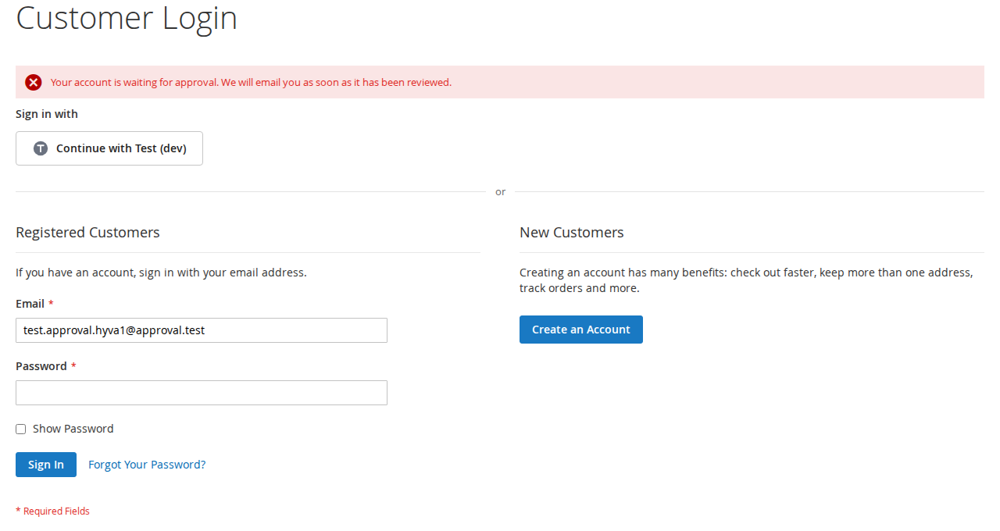
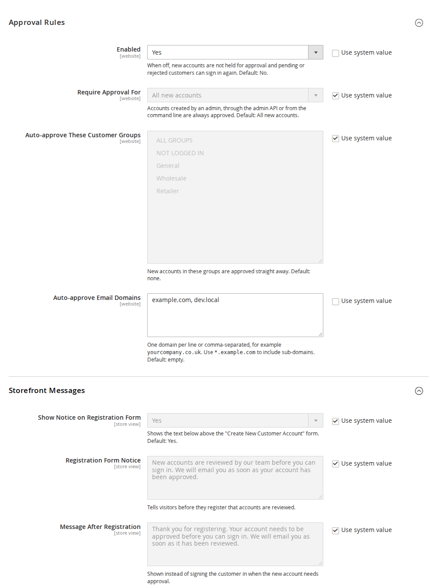
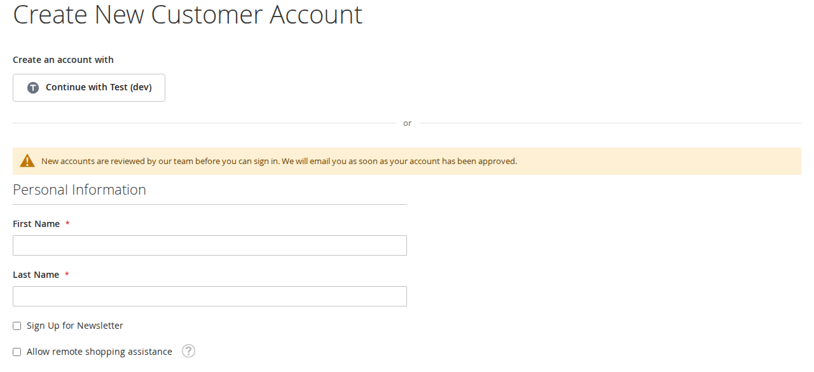
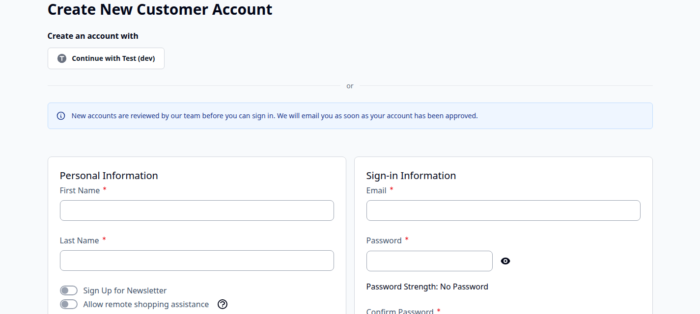
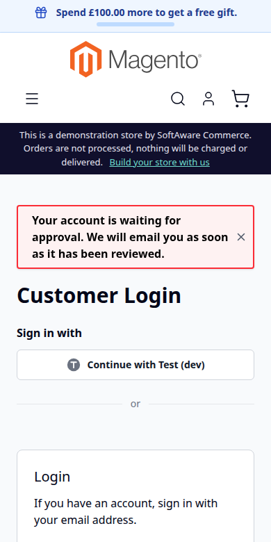
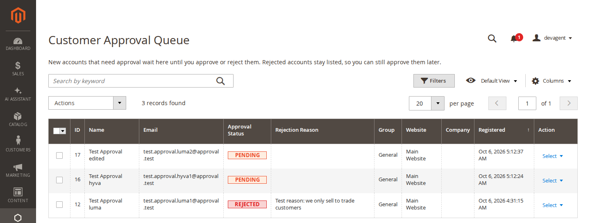
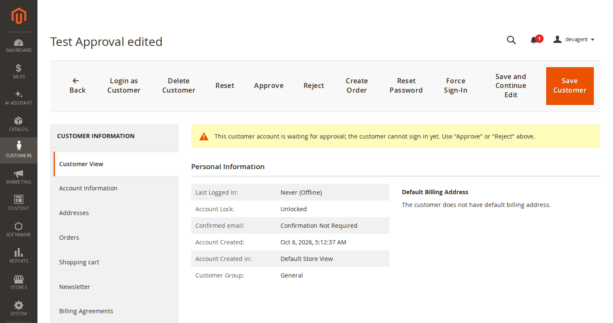

# Customer Approval for Magento 2: User Guide

New customer accounts wait for approval by your team before they can sign in. You decide which accounts need
approval, approve or reject them in the admin, and the module emails your team and your customers. This guide covers
installation, every setting and day-to-day use.

- Admin demo: https://demo.softawarecommerce.com/try-admin/customer-approval
- Changelog: [CHANGELOG.md](../CHANGELOG.md) · Questions: [FAQ](faq.md)

On the public demo storefront approval is switched off, so visitors can register and try the other modules. The
admin demo shows the Approval Queue, the customer page buttons and the settings.



## 1. Requirements

| | |
| --- | --- |
| Magento | Magento Open Source or Adobe Commerce 2.4.7 to 2.4.9 |
| PHP | 8.2 to 8.5 |
| Themes | Luma, Blank and themes based on them; Hyvä 1.3 or later |
| Other | `softaware/module-core` (installed automatically) |

## 2. Installation

Install with Composer from repo.softawarecommerce.com. Your access keys and the full set-up are described at
https://softawarecommerce.com/shop/composer-access/.

```bash
composer config repositories.softaware composer https://repo.softawarecommerce.com
composer config --auth http-basic.repo.softawarecommerce.com PUBLIC_KEY PRIVATE_KEY
composer require softaware/module-customer-approval
bin/magento setup:upgrade
bin/magento setup:di:compile            # production mode only
bin/magento setup:static-content:deploy # production mode only
bin/magento indexer:reindex customer_grid
bin/magento cache:flush
```

The reindex adds the "Approval Status" column to the customer grid. All customers that exist at installation are
marked as approved. On Hyvä, run your usual Tailwind build after installing so the registration notice is styled (the
module registers itself for Hyvä's Tailwind source scanning).

To update later: `composer update softaware/module-customer-approval`, then the same `bin/magento` commands.

## 3. Quick start

1. Go to **Stores > Configuration > Softaware > Customer Approval** (also under **Softaware > Customer Approval >
   Settings**) and choose the website in the scope switcher.
2. **Approval Rules > Enabled = Yes.** By default every new account then needs approval.
3. Enter your team's address under **Email to Shop Team > Recipients**, so someone hears about new accounts.
4. Save. Register a test account on the storefront: you are not signed in and see the approval message.
5. Open **Softaware > Customer Approval > Approval Queue**, approve the account, and sign in with it.

## 4. Settings

Approval rules and the shop team email are set per website; storefront messages and customer emails per store view.
Every field shows its default in the comment and has "Use system value".



### Approval Rules

| Setting | What it does |
| --- | --- |
| Enabled | When No, new accounts are not held for approval and pending or rejected customers can sign in again. Default: No. |
| Require Approval For | **All new accounts** or **Selected customer groups**. Accounts created by an admin, through the admin API or from the command line are always approved. Default: All new accounts. |
| Customer Groups That Need Approval | With "Selected customer groups": the groups whose new accounts need approval. This is the group the new account is assigned to (by default "Default Group" under Customers > Customer Configuration > Create New Account Options). If none is selected, no account needs approval. |
| Auto-approve These Customer Groups | With "All new accounts": new accounts in these groups are approved straight away. Default: none. |
| Auto-approve Email Domains | One domain per line or comma-separated, for example `yourcompany.co.uk`. Use `*.example.com` to include sub-domains. Default: empty. |

### Storefront Messages

| Setting | What it does |
| --- | --- |
| Show Notice on Registration Form | Shows the notice below above the "Create New Customer Account" form. Default: Yes. |
| Registration Form Notice | Tells visitors before they register that accounts are reviewed. |
| Message After Registration | Shown instead of signing the customer in when the new account needs approval. |
| Sign-in Message: Pending | Shown on the login form and the checkout login when a pending customer tries to sign in. |
| Sign-in Message: Rejected | Shown on the login form when a rejected customer tries to sign in. |
| After Registration, Go To | The login page, or a CMS page that explains your approval process. Default: Login page. |

### Email to Shop Team

| Setting | What it does |
| --- | --- |
| Email on New Account Waiting for Approval | Emails the recipients when a new account is waiting for approval. Default: Yes. |
| Recipients | Comma-separated email addresses, for example sales@example.com. No email is sent while this is empty. |
| Email Template | The template for this email. |

### Emails to Customers

| Setting | What it does |
| --- | --- |
| Email Sender | The store email identity used for all emails of the module, including the one to the shop team. Default: General Contact. |
| Send "Account Approved" Email | Tells the customer they can now sign in. Default: Yes. |
| "Account Approved" Template | The template for this email. |
| Send "Account Not Approved" Email | Tells the customer the account was not approved. Default: Yes. |
| "Account Not Approved" Template | The template for this email. |
| Include Rejection Reason in Email | Adds the reason entered when rejecting. Default: No. |

To change the wording of an email, create a template from the module's template under **Marketing >
Communications > Email Templates** and select it in the setting.

## 5. What your customers see

**Before registering.** With "Show Notice on Registration Form" on, a notice above the registration form explains
that new accounts are reviewed. Luma and Hyvä each have their own template.

| Luma | Hyvä |
| --- | --- |
|  |  |

**After registering.** If the account needs approval, the customer is not signed in. "Thank you for registering" is
replaced by your "Message After Registration", and the customer is sent to the login page or your CMS page. This
also applies to accounts created at checkout or through a social login.

**Signing in.** A pending or rejected customer who tries to sign in sees the message for their status and stays
signed out. The same customer is also refused on:

- the checkout sign-in popup;
- REST (`POST /V1/integration/customer/token`) and GraphQL (`generateCustomerToken`) customer tokens;
- the RSS feed login;
- password-less sign-ins: social login, the email confirmation link, the automatic sign-in after registration, Login
  as Customer on the storefront and through GraphQL (`generateCustomerTokenAsAdmin`), and store switching.

Through the REST and GraphQL token endpoints Magento replaces every sign-in error with its generic message.



**After approval.** The customer gets the "Account Approved" email and can sign in as usual. If you reject the
account, the customer gets the "Account Not Approved" email, with the reason if you enabled that.

## 6. Approving and rejecting

### Approval Queue

**Softaware > Customer Approval > Approval Queue** lists the pending and rejected accounts with ID, name, email,
approval status (Pending, Rejected), rejection reason, group, company, country, website (under Columns) and
registration date. Search by keyword (name, email address and the other indexed customer fields) or filter the
columns. Rejected accounts stay listed, so you can still approve them later.



- Mass actions: **Approve** and **Reject**.
- Row actions: **View Customer**, **Approve** and **Reject**. To add a rejection reason, use the Reject button on the
  customer page.

The menu item shows the number of waiting accounts, for example "Approval Queue (2)", and a message in the admin
notice bar says how many accounts are waiting.

### Customer page

On **Customers > All Customers > edit customer** a notice shows the approval status, and the toolbar has **Approve**
and **Reject** buttons. Reject asks for an optional reason, which is stored with the account and shown in the queue.



### Customer grid

**Customers > All Customers** has an "Approval Status" column with a filter, and the mass actions **Approve
Account** and **Reject Account** under Actions.

### Rejecting or resetting a customer

Rejecting a customer, or setting them back to pending, signs them out of the storefront, ends "Remember Me" sessions
and revokes their API tokens. Customers cannot change their own status: the approval attributes are not in any form,
and a status sent with a customer save is ignored.

### Permissions (ACL)

Under **System > Permissions > User Roles > Role Resources > Softaware > Customer Approval**:

| Resource | Allows |
| --- | --- |
| Approve and Reject Customers | The Approval Queue, the customer page buttons, the mass actions and the REST API |
| Settings | Stores > Configuration > Softaware > Customer Approval |

The customer grid mass actions are visible to every admin who can see the customer grid, but they only work with
the "Approve and Reject Customers" permission.

## 7. Command line

```bash
bin/magento softaware:customer-approval:status                          # list pending accounts
bin/magento softaware:customer-approval:status --status=rejected        # list rejected (or approved) accounts
bin/magento softaware:customer-approval:status jane@example.com --set=approved [--no-email]
bin/magento softaware:customer-approval:status 42 --set=rejected --reason="Trade customers only"
bin/magento softaware:customer-approval:status 42 --set=pending
```

A customer is given by ID or email address; use `--website=<id>` when the same email exists on several websites.
`--no-email` changes the status without emailing the customer.

## 8. REST API and events

With an admin token and the "Approve and Reject Customers" permission:

```
GET  /V1/softaware/customer-approval/:customerId            -> "pending" | "approved" | "rejected"
POST /V1/softaware/customer-approval/:customerId/approve     {"notify": true}
POST /V1/softaware/customer-approval/:customerId/reject      {"reason": "...", "notify": true}
POST /V1/softaware/customer-approval/:customerId/pending
```

The event `softaware_customer_approval_status_changed` (with `customer`, `previous_status`, `status` and `reason`) is
dispatched on every change, for example to send the status to a CRM.

## 9. Troubleshooting

| Problem | Solution |
| --- | --- |
| New accounts are not held for approval | Check **Enabled** for the website (not only the default scope), the **Require Approval For** setting, the selected groups and the auto-approve groups and domains. Accounts created in the admin are always approved. |
| The customer grid has no "Approval Status" column | Run `bin/magento indexer:reindex customer_grid`. |
| The team gets no email | Fill in **Recipients**; no email is sent while it is empty. Check that Magento can send email. |
| A customer cannot sign in after approval | Check the status on the customer page. Through REST or GraphQL, refused attempts count towards Magento's account lockout; unlock the account under Account Lock if needed. |
| The link in the team email opens the dashboard | The link has no admin secret key. With "Add Secret Key to URLs" on, the admin opens the dashboard first. |
| The registration notice looks unstyled on Hyvä | Rebuild the Hyvä theme CSS after installing or updating. |

## 10. Uninstall

```bash
bin/magento module:disable Softaware_CustomerApproval
composer remove softaware/module-customer-approval
bin/magento setup:upgrade
```

Once the module is removed, nobody is held for approval: pending and rejected customers can sign in again. The
customer attributes `softaware_approval_status` and `softaware_approval_reason` stay in the database until you
remove them.
